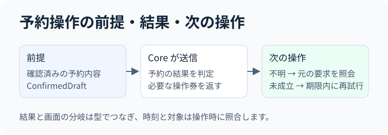
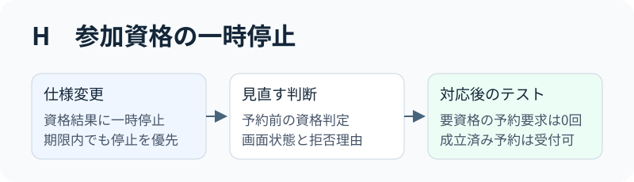

# Decision Contract Architecture

**仕様が変わったとき、見直すべき業務判断をコンパイラの診断からたどる。**

ワークショップの予約要求に応答がないとき、もう一度送ってよいでしょうか。最初の予約が成立していれば、再送は重複につながります。Decision Contract Architecture（DCA）は、業務操作の前提、結果、次に許される操作を型で表し、その型を利用側が直接参照する設計です。

[最小の JVM サンプルを実行する](examples/reservation-jvm/README.md) · [KMP 版を図で読む](examples/reservation-mobile/docs/README.md) · [SwiftUI 版を試す](examples/reservation-ios/README.md)

## 予約フローで見る DCA

Core が確認済みの予約内容を発行し、送信にはその値を要求します。送信後は結果に応じて、画面が利用者に案内できる操作が変わります。



結果を `sealed` 型で表し、画面への変換を `else` のない `when` で書くと、結果を追加したときに対応漏れをコンパイラが検出します。Core は操作券を現在の状態と照合し、新しく予約要求を送る直前に期限を確認します。開始時刻ちょうどに作成要求を送らないことはテストで確かめられます。 [JVM 版の図解](examples/reservation-jvm/docs/README.md) · [設計思想と判断契約](docs/architecture.md)

## 仕様変更で何が見つかるか



Android・iOS で画面を共有する KMP 版は、参加資格、予約、来場受付を3つの Core に分けています。参加資格に「一時停止」を加えると、予約前の判断や画面表示で対応が必要な箇所にコンパイル診断が出ます。対応後のテストでは、一時停止中に資格が必要な予約の作成要求が送られず、成立済みの予約で来場を受け付けられることを確かめます。 [変更実験 H](docs/experiments/h-suspended-qualification.md) · [診断とテストの記録](docs/mobile-app/verification-results.md#変更実験-hl)

比較実験では、未対応の `when` に `else` を加えるとコンパイルが通り、detekt がその `else` を報告します。 [比較実験 C1](docs/experiments/contract-comparisons.md) · [detekt のルール](docs/detekt-rules.md)

## 自分のプロジェクトで試す

次の操作が結果によって変わる機能を一つ選んでください。結果ごとに許される操作を書き出し、利用側が結果の違いを型で受け取れる形にします。JVM サンプルを実行すると、予約結果にケースを一つ加えたとき、未対応の画面変換に診断が出ることを確認できます。 [JVM 版の実行手順](examples/reservation-jvm/README.md)

[KMP 版の実行手順](docs/mobile-app/setup.md) · [サンプル一覧](examples/README.md) · [ドキュメント索引](docs/README.md)

## dca Plugin で既存プロジェクトに導入する

既存プロジェクトの一つの業務フローに DCA を段階的に導入するための Plugin を、[plugins/dca](plugins/dca) に置いています。Claude Code と Codex CLI で使えます。Skill は 8 つで、業務フローの判断と保証の所在を整理する `map`、問題を調べる `scan`、未決の判断を合意する `interview`、段階移行を進める `refactor`、Lint を提案する `lint`、入口を案内する `guide`、原則を説明する `principles`、構成図を示す `overview` です。構成は [dca の構成図](plugins/dca/docs/overview.svg)で読めます。

手元に clone したこのリポジトリのルートで次のコマンドを実行します。このリポジトリを marketplace として追加し、`dca` を導入します。

```bash
claude plugin marketplace add "$PWD"
claude plugin install dca@dca-plugins

codex plugin marketplace add "$PWD"
codex plugin add dca@dca-plugins
```

導入したら、導入先のプロジェクトで `guide` を使います。Claude Code では `/dca:guide` と入力します。Codex CLI では、`/skills` を開くか `$` を入力して `dca:guide` を選びます。`guide` の役割は、目的を一つ選び、次に使う Skill を案内することです。`guide` 以外の Skill は、利用者が明示して選んだときだけ動きます。

調査、合意、移行の進捗は、リポジトリ外のローカルの領域（`DCA_STATE_DIR`、`XDG_STATE_HOME` の下の `dca`、`~/.local/state/dca` の順）に保存します。導入先のリポジトリには、CLAUDE.md や docs などの記録を作りません。

コード移行の対象は Kotlin/JVM と Kotlin Multiplatform です。SwiftUI では、操作を持つ画面入力の更新について、原則の確認、経路の調査、検査の提案に使えます。 [画面操作の更新](docs/mobile-app/ui-operation-updates.md)

初期版の導入と Skill の登録はホストで確認済みです。保存や識別、構成図には自動検査があり、モデルを呼ぶ評価は未実施です。 [評価ケースと実行方法](plugins/dca/evals/README.md)
