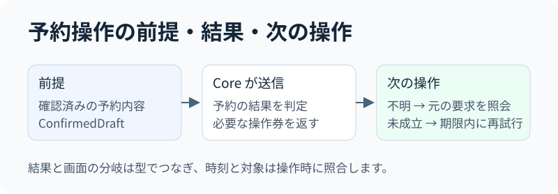

# ドキュメント索引

## サンプルを図で読む

| サンプル | 図解 | 実行手順 |
| --- | --- | --- |
| Kotlin/JVM | [一つの予約フローの依存関係と検査](../examples/reservation-jvm/docs/README.md) | [JVM 版のセットアップ](../examples/reservation-jvm/README.md) |
| Android・iOS | [3つの Core の依存関係と検査](../examples/reservation-mobile/docs/README.md) | [モバイル版のセットアップ](mobile-app/setup.md) |

## 設計と基準仕様

| 知りたいこと | 参照先 |
| --- | --- |
| 前提・結果・次の操作の関係 | [設計思想と判断契約](architecture.md) |
| モバイル版で判断を持つ箇所 | [モバイルアプリへの適用](mobile-app/architecture.md) · [3つの Core の判断契約と依存関係](mobile-app/core-contracts.md) |
| 確認済みの値を使える条件と時点 | [判断済みの値が使える時点](mobile-app/contract-evidence.md) |
| 業務と画面の流れ | [参加資格](mobile-app/qualification.md) · [予約の作成・照会・取消](mobile-app/screens.md#予約の作成照会取消) · [来場受付](mobile-app/check-in.md) · [画面と操作](mobile-app/screens.md) |
| ビルド対象と技術の選定 | [検証アプリの技術選定](mobile-app/technology.md) |

## 仕様変更の検証

[検査の種類と変更課題 A〜G](verification.md) · [detekt の運用ルール](detekt-rules.md) · [診断とテストの記録](mobile-app/verification-results.md)

| 変更実験 | 検知点を図で読む |
| --- | --- |
| H | [資格に一時停止を追加する](experiments/h-suspended-qualification.md) |
| I | [来場時に資格を再確認する](experiments/i-check-in-qualification.md) |
| J | [予約に利用停止を追加する](experiments/j-suspended-reservation.md) |
| K | [資格不要の新規予約を廃止する](experiments/k-required-qualification.md) |
| L | [資格サービスの形式を変更する](experiments/l-qualification-wire-format.md) |
| C1〜C3 | [判断契約の制約を弱める比較](experiments/contract-comparisons.md) |
