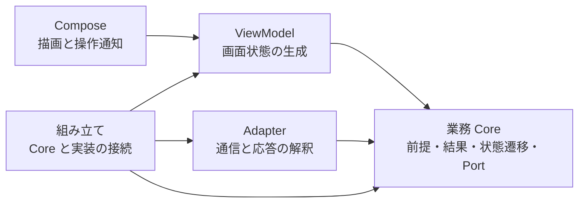
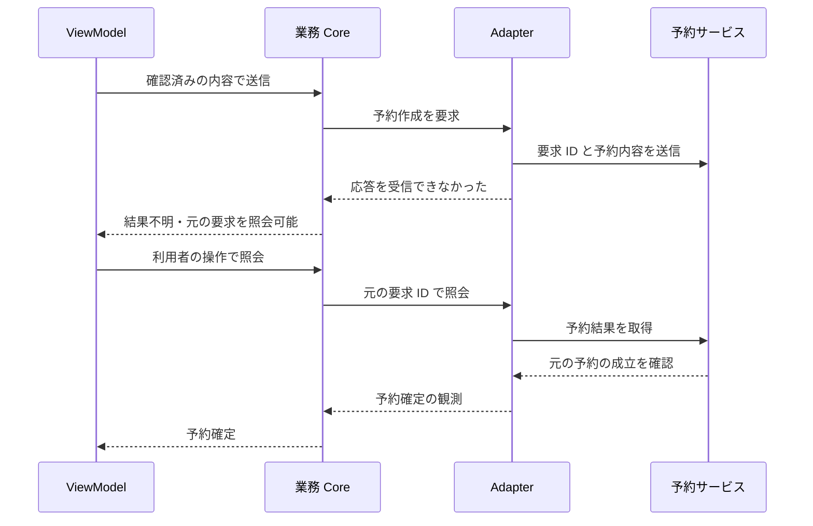

# Android と KMP への適用

予約の可否と結果の解釈は、予約の業務 Core が所有します。Android の ViewModel は操作を Core へ渡し、結果を画面状態に変換します。Compose はその状態を描画し、操作を ViewModel へ伝えます。画面から Core、画面状態から Compose という流れは、Android の単方向データフローに沿います。[Android のアーキテクチャ推奨事項](https://developer.android.com/topic/architecture/recommendations)

## 責務と依存方向

図の矢印は、コードが静的に参照する向きです。Port は Core が外部に求める操作のインターフェースです。図は Port の宣言を Core に置く構成を示します。

Core は結果の意味と、次に許される操作を公開します。ViewModel はその結果から画面状態を作り、Compose は文言やボタンを選びます。取消ボタンの表示は、Core から渡された操作が画面にあることを表します。押下時に取消期限を再判定する責務は Core が持ちます。

Adapter は外部の応答を検証し、Port が定義する観測結果に変換します。予約送信後に応答を確認できず成立を判定できない場合、Core が結果不明として扱える観測を渡します。外部の未知コードを受け止める経路は Adapter に置き、既知の業務結果が増えた場合は Core の契約に反映します。DTO や SDK 型は外部形式を扱う境界に留めます。

組み立ては具体的な Adapter を選び、Core の必須依存として渡します。UI には組み立て済みの操作を渡します。公開 factory が UI のコンパイルクラスパスにも見えるときは、呼び出しを静的検査で制限します。モジュール間に禁止した依存が加わることは Gradle で検査します。`internal` の範囲は Kotlin のコンパイルモジュールです。フォルダを分けるだけでは、構築や依存を拒否できません。[Kotlin の可視性](https://kotlinlang.org/docs/visibility-modifiers.html)

## 応答が失われたとき

矢印は呼び出しと応答の順序を表します。予約の成立をサービスが確認するまで、ViewModel が表示できるのは結果不明の画面状態です。

## 再生成と操作の有効性

画面再生成後は、現在の業務状態から画面を描き直します。復帰や再購読を送信のきっかけにすると、前回の要求が成立している場合に重複が起きます。同時実行を扱う Core は、操作の有効性を確かめて送信中に移すまでを一つの排他区間で行います。送信中に届いた重複操作は、外部要求を作る前に拒否します。通信後に成立を確認できなければ、元の要求を照会します。

プロセス終了後の復元を扱う場合は、画面の復元に使う ID と、結果を再照会するために必要な永続情報の責務を決めます。Android の `SavedStateHandle` は画面を再構築する少量の情報に使えます。予約の成立や送信済みの事実は、サービスや永続記録で確認します。[Android の UI 状態保存](https://developer.android.com/topic/libraries/architecture/saving-states?hl=en)

## サンプルと実アプリの境界

[サンプル](../examples/README.md)は、Android SDK から独立した Kotlin/JVM で判断契約を確認します。Android の画面、ライフサイクル、ネットワーク、分散環境での重複防止を検証するには、実アプリとサービスの境界を接続して試験します。Swift 向けの公開契約も扱う場合は、実際に生成した成果物を使い Swift の利用側をコンパイルします。

責務・Port・Swift 境界の設計根拠は `usapo-type-driven-design` の `08-module-structure.md`、`09-external-adapters.md`、`12-swift-boundary.md` です。
