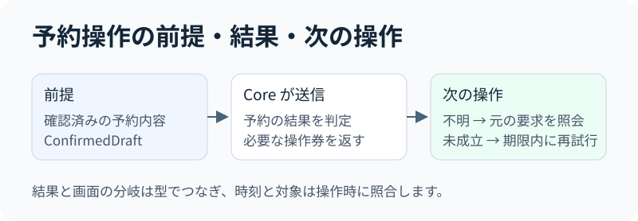
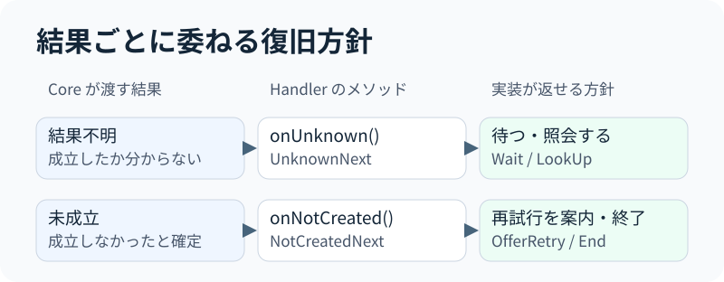

# 設計思想と判断契約



判断契約とは、業務操作の前提、操作が返す結果、その結果に対して許される次の操作を定めた公開契約です。Decision Contract Architecture（DCA）では、仕様を変更したときに見直しが必要な処理が、その契約の型を直接参照するように設計します。たとえば、外部サービスの応答を解釈する処理と、結果に応じて表示を選ぶ処理が該当します。

## 予約結果ごとに許される操作

| 判明していること | Core が許す次の予約操作 | 実行時に確かめること |
| --- | --- | --- |
| 未成立が確定した | 明示的な再試行 | 再試行の対象が現在の未成立結果と一致し、開催回の開始時刻より前であること |
| 予約が成立したか分からない | 元の要求の状況照会 | 照会が元の要求 ID を使い、新規予約を送信しないこと |
| 満席で成立しなかった | 開催回や参加内容を選び直す | 画面の残席表示と異なっても、サービスの結果に従うこと |

照会で記録が見つからない場合や照会に失敗した場合、Core は結果不明の状態を保ちます。結果が不明なまま再試行すると、元の予約が成立していたときに重複します。

成否を一つの `Boolean` で返すと、利用側は照会と再試行のどちらを案内できるか判断できません。操作固有の `sealed` 型で結果を表し、すべてのケースに対応する必要がある箇所では `else` のない `when` を使います。結果型にケースを追加すると、コンパイラが未対応の分岐を検出します。元の結果の区別を必要とする処理に、その型への依存を置きます。[Kotlin の sealed 型](https://kotlinlang.org/docs/sealed-classes.html)

照会は Core が送信時に発行した要求 ID を使います。未成立が確定した後の再試行は新しい要求です。再試行で応答が失われたら、その新しい要求を照会します。元の要求の結果が不明なまま開始時刻を過ぎても、照会は続けられます。

## 操作に必要な前提と有効期限

確認前の入力と、利用者が確認した内容を別の型で表します。Core は確認操作で開催回と参加者を確かめ、確認時点の内容を保持する値を作ります。送信にはその値が必要です。サンプルで Core のモジュール外から確認済みの値を直接作れないよう、`ConfirmedDraft` のコンストラクタを `internal` にしています。確認後に開催回や参加者が変わった場合は、新しい内容で確認し直します。

確認済みの値が表すのは、利用者がその内容を確認した時点の事実です。Core は操作を受け付ける時点で、その値が現在の状態と対象に対応しているかを確認します。新規送信では期限も確認します。開催回の開始時刻を `start`、送信直前の時刻を `now` とすると、新規送信の時刻条件は `now < start` です。

確認済みの値を二度渡す呼び出しもコンパイルできます。サンプルの Core は、渡された値が現在の値と同じインスタンスかを `===` で確かめます。同じ内容を確認し直した場合も、使えるのは現在の値だけです。開始時刻ちょうどかそれ以降に再試行を受けた場合、Core は新規送信を拒否し、元の要求が未成立だったという事実を保持します。

## Handler で委ねる判断



予約で許される復旧操作が仕様により一意に決まる場合は、Core が結果を網羅的に扱い、次の操作を決めます。業務方針が正当に複数あり、選択を別の実装に委ねる場合は、Core が必須の Handler を定義します。結果ごとに戻り値型を分けると、たとえば結果不明を受けるメソッドから再試行を返せません。Handler の抽象メソッドと組み立て時の必須引数で、処理や接続の不足をコンパイラが検出できます。

次は、確定した失敗を受けて終了または再試行を案内する方針と、結果不明を受けて待機または照会する方針を、実装側に委ねる別の業務の例です。

```kotlin
enum class NotCreatedNext { OfferRetry, End }
enum class UnknownNext { Wait, LookUp }

interface RecoveryHandler {
    fun onNotCreated(): NotCreatedNext
    fun onUnknown(): UnknownNext
}
```

組み立て側が `RecoveryHandler` を渡し、Core が結果に対応するメソッドを呼びます。たとえば `onUnknown()` から `NotCreatedNext.OfferRetry` を返す実装は型が一致しません。`OfferRetry` は表示する選択肢です。利用者が選んだ後の再試行には、操作時点の前提を確認する処理が必要です。

結果型にケースを追加すると、まずそれを網羅する `when` が失敗します。別の判断が必要なら Handler に必須メソッドを追加し、その実装の対応漏れを検出できます。結果型と Handler の二つを手書きする場合は、同じ変更で両方を更新します。更新箇所が増え、Kotlin の宣言から機械的に導ける部分が明確になったら、コード生成を検討します。

## 適用範囲

操作の前提、実行結果、復旧経路の変更が別々の所有者に影響する機能で効果を確かめられます。失敗時の扱いが一種類で、呼び出し側に再判断も求めない操作なら、通常の型と局所的な分岐で足ります。型を増やすかどうかは、拒否したい操作と、仕様変更時に判断を見直す必要がある利用側を基準に決めます。

## 必須の原則と任意の技法

DCA では判断の所有者、公開する値の意味、発行できる箇所、仕様変更時に再判断する利用側を定めます。型検査が働くと説明する場合は、通常の利用側と同じコンパイル境界で正例と負例を確かめます。対象や時刻が一致するか、外部操作が重複しないかは、状態と操作を所有する Core が実行時に判断します。

実際に判断を委ねる場合は Handler を使えます。独立した判断だけを小さな純粋関数に分けると、外部操作を伴わず境界値を確認できます。宣言から決まる接続が増えた場合には生成も選べます。生成した接続に業務判断を補う既定動作を持たせると、利用側の未対応を検出できなくなります。

## 参考にした設計技法

- 業務上成立する状態と操作を契約の型に表します。このリポジトリでは、予約内容の確認と予約の成立が異なる操作を許します。[Domain Modeling Made Functional](https://pragprog.com/titles/swdddf/domain-modeling-made-functional/)
- 境界で入力を解釈し、判明した内容を値に持たせます。資格 Adapter は外部形式を解釈し、参加資格 Core が判定時点の証明書を発行します。[Parse, don’t validate](https://lexi-lambda.github.io/blog/2019/11/05/parse-don-t-validate/)
- 結果にケースが増えたときは、網羅性の検査で見直す箇所を見つけます。検証アプリでは課題 H と J で診断を記録します。[Jane Street の網羅性チェック](https://blog.janestreet.com/what-do-haskellers-have-against-exhaustiveness/)
- 判定と外部操作を分けると、境界時刻や判断の変換を単独で検証できます。検証アプリでは参加資格の観測を取得してから、期限の比較と画面への変換を行います。[Functional Core, Imperative Shell](https://www.destroyallsoftware.com/screencasts/catalog/functional-core-imperative-shell)

Session Types や依存型は、より多くの前提を型で表す発展的な選択肢です。このサンプルで観測する保証は、Kotlin のコンパイル、ビルド時の規約、実行時の振る舞いに基づきます。各検証が受け持つ範囲は [仕様変更を使った検証](verification.md) を参照してください。
