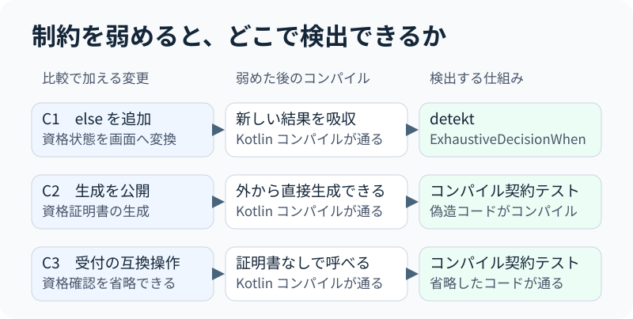

# 判断契約の制約を弱める比較



比較 C1〜C3 は、通常のアプリをコピーして一つずつ制約を弱めます。検証用の差分は一時ディレクトリだけに適用します。内側の Kotlin コンパイル、detekt、利用コードの拒否テストが示した結果を個別に照合し、期待する差が成立した場合に比較全体が成功します。

| 比較 | 通常の契約 | 比較で変更する制約 | 観測する検査 |
| --- | --- | --- | --- |
| C1 | 資格状態から画面への変換が全ケースを列挙する | 新ケースを汎用の `else` で吸収する | 新ケース追加時に Kotlin が網羅性エラーを出すこと、弱化後は同じ箇所が Kotlin で通り detekt が違反として報告すること |
| C2 | 参加資格 Core が `EligibilityCertificate` を発行する | コンストラクタの可視性だけを公開へ変える | 別モジュールの同じ利用コードが通常版では拒否され、弱化後はコンパイル可能になること。拒否テストは後者を失敗として報告する |
| C3 | 課題 I の要資格予約で、受付に資格確認が必須になる | 要資格予約の受付に引数1つの互換操作を加える | 資格確認を渡さない同じ利用コードが通常版では拒否され、弱化後はコンパイル可能になること。比較はコンパイルまで行う |

C1 は H の資格結果を追加して上流の予約判断に対応した状態から、画面への変換を調べます。C2 は基準仕様のコンストラクタを対象にします。C3 は I に対応した版を起点とし、資格不要の予約に使う受付操作を比較の対象から外します。

## 実行

Android 用 Nix シェルで `examples/reservation-mobile/` に移動し、次を実行します。

```sh
./gradlew verifyComparisons
```

一つだけ実行する場合は、リポジトリのルートで実験 ID を指定します。

```sh
python3 examples/reservation-mobile/verification/experiments/run.py c1 --evidence runs/contract-comparisons/c1
```

各実験の `steps.json` に対象、ステップと期待診断を記載しています。Gradle タスクは `examples/reservation-mobile/build/reports/contract-comparisons/` に実行時のソース識別情報、ログ、診断を保存します。[実験の定義](../../examples/reservation-mobile/verification/experiments/) · [検証記録](../mobile-app/verification-results.md)
