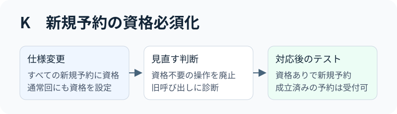

# K 新規予約の資格必須化

すべての新規予約に資格確認を要求します。従来の通常回には「基礎安全講習修了」を設定し、資格確認を経由しない公開経路を廃止します。

## 確認する変更

コンパイラが、廃止した予約操作を呼ぶ旧経路を検出します。有効な資格確認を渡す予約は作成できます。以前に資格なしで成立した予約は履歴と有効性を保持し、基準仕様の来場受付を利用できます。資格の有効期限を判定するルールは維持します。
