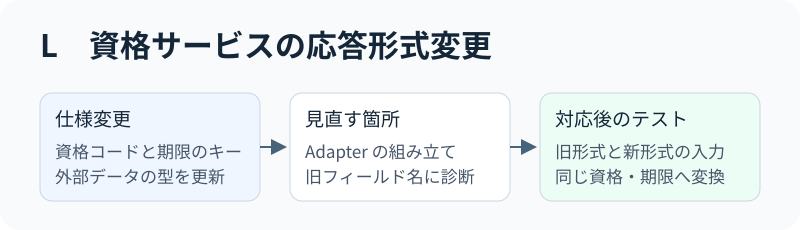

# L 資格サービスの応答形式変更

資格コードや期限を表すフィールド名を変更します。資格の種類、期限、有効性の判定は同じです。変更前後の具体的な入力を固定し、Adapter が同じ業務上の観測結果を返すことを確認します。

| 形式 | 固定入力 |
| --- | --- |
| 変更前 | `held=true&code=POTTERY-ADV&valid_until=2028-01-01T12:00:00Z` |
| 変更後 | `held=true&qualification_code=workshop.pottery.level2&expires_at=2028-01-01T12:00:00Z` |

## 確認する変更

型付きの外部データを構築するコードは、新しい型と一致する必要があります。外部入力のキー、未知のコード、不正な期限の扱いは Adapter のテストで確かめます。各形式にもう一方の版の入力を渡した場合も、資格を発行しません。参加資格 Core、予約 Core、来場受付 Core、共通画面の契約は維持します。
