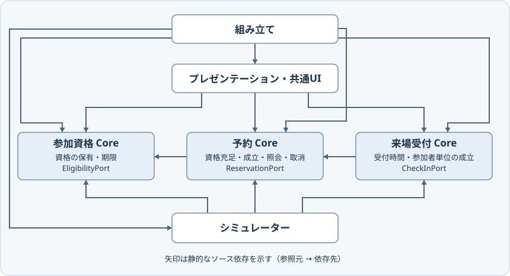
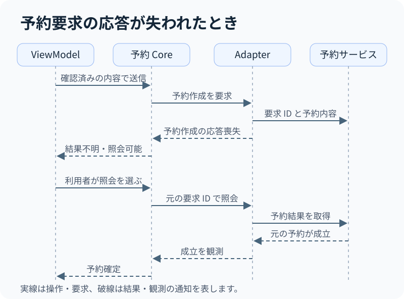

# モバイルアプリへの適用

参加資格、予約、来場受付の条件は、それぞれを所有する Core が決めます。Compose Multiplatform の画面は利用者の操作を伝え、Core から変換した画面状態を描画します。OS ごとの入口が起動とライフサイクルを接続します。

## 責務と依存方向

各 Core の役割は [3つの Core の判断契約](core-contracts.md) を参照してください。

Core は結果の意味と、次に許される操作を公開します。ViewModel はその結果から画面状態を作り、Compose は文言やボタンを選びます。たとえば取消操作が渡された画面には、Compose が取消ボタンを表示します。利用者がボタンを押した時点の取消期限は Core が確認します。

Adapter は外部の応答を検証し、Port が定義する観測結果に変換します。予約送信後に応答を確認できず成立を判定できない場合、Core が結果不明として扱える観測を渡します。未定義の応答コードは Adapter で扱います。仕様で業務結果が追加された場合は、Core の契約にも新しい結果を加えます。通信や SDK に固有の型は Adapter 内に留めます。

組み立てを担当するコードが Adapter の実装を選び、Core の必須引数として渡します。UI は組み立て済みの Core の操作を受け取ります。UI からも公開 factory を参照できる構成では、静的検査で呼び出し元を制限します。Gradle では、モジュール間に禁止した依存が加わっていないかを検査します。Kotlin の `internal` が制限するのは、コンパイルモジュール外からの参照です。[Kotlin の可視性](https://kotlinlang.org/docs/visibility-modifiers.html)

## 応答が失われたとき

応答を受け取れなかった場合、ViewModel は結果不明を表す画面状態を作ります。図は、利用者が元の要求を照会して予約の成立を確認できた場合の呼び出しと応答を示します。

## 再生成と操作の有効性

画面を再生成したときは、現在の業務状態から画面を描き直します。復帰や再購読のたびに要求を送ると、前回の要求が成立していた場合に予約が重複します。同時実行を扱う Core は一つの排他区間で操作が有効かを確かめ、状態を送信中へ移します。送信中に届いた重複操作は、外部要求を作る前に拒否します。通信後に成立を確認できなければ、元の要求を照会します。

プロセスが終了すると、検証アプリがメモリに保持する下書き、予約、受付の状態は失われます。プロセスをまたぐ復元は課題 G で扱います。[課題 G の確認項目](../verification.md#予約アプリで評価する変更)

## 検証用アプリでの状態管理

[検証アプリ](setup.md)では、組み立て時にプロセスで共有する Core を作ります。予約 Core が下書きと予約要求、成立済みの予約を管理し、来場受付 Core が参加者ごとの受付状態を管理します。画面が切り替わっても、元の要求を照会できます。

[Kotlin/JVM のサンプル](../../examples/reservation-jvm/README.md)では、確認済みの値や結果の分岐をコンパイラがどう検査するかを確認できます。検証アプリでは、シミュレーターの応答と Android・iOS の画面操作を使って、業務条件と各 OS への接続を確かめます。
