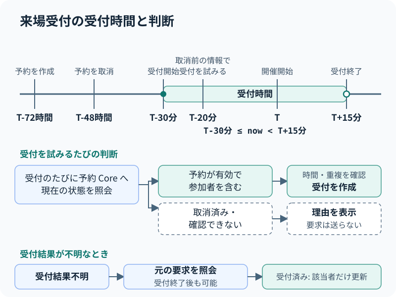

# 来場受付

来場受付は、現在有効な予約に含まれる参加者を一人ずつ受け付ける操作です。2人の予約で片方を受け付けても、もう片方は未受付のままです。

## 受付条件

来場受付 Core は、受付時間内に処理を始めるたびに予約 Core へ照会します。予約 Core は予約が有効で、対象の参加者を含むことを確認します。来場受付 Core はその確認、受付時刻、参加者ごとの受付状態から受付の可否を判断します。開催開始時刻を `T`、判定時刻を `now` とすると、受付時間は `T - 30分 <= now < T + 15分` です。

基準仕様では、有効な予約に含まれる参加者を受け付けるときに資格を再確認しません。過去に成立したという記録と、現在有効な予約の確認は区別します。たとえば `T - 72時間` に作成した予約を `T - 48時間` に取り消した場合、`T - 20分` に取消前の情報を渡しても受付要求を送信しません。

## 受付結果と照会

参加者ごとに受付の状態を管理します。予約が無効、あるいは予約の有効性を確認できない場合は、理由を表示します。受付の未成立が確定した場合は、利用者の操作で新しい試行を開始できます。処理中の同じ操作の再タップや画面復帰では、要求を追加しません。

受付結果が不明な間は元の受付要求を照会できます。照会は受付終了後も可能です。記録が見つからない場合と照会に失敗した場合は、受付結果不明のままです。受付済みと確認できた場合は、照会した参加者の受付だけを更新します。予約作成と来場受付は別の要求識別子を使います。
