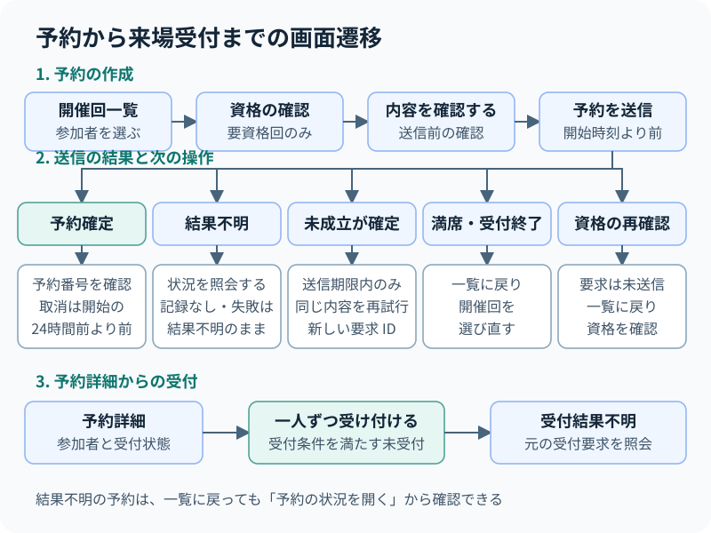

# 予約と来場受付の共通画面

Android と iOS は、開催回一覧、予約内容の確認、予約状況と予約詳細を共有します。利用者の操作を Core へ渡し、Core が決めた状態を画面に反映します。

## 予約時の資格確認

要資格回では、現在選んでいる参加者ごとに確認結果を表示します。未取得、期限切れ、確認結果不明の場合は、それぞれの状態を示します。確認結果が不明な場合は資格の再照会を案内します。全員の条件がそろうと予約送信へ進めます。

## 予約の作成・照会・取消

開催回と参加者を選び、「内容を確認する」で送信前の内容を確認します。予約の送信と再試行は開催開始時刻より前に行えます。成立した予約の取消期限は開催開始の24時間前で、取消は期限より前に限ります。

| 予約の作成結果 | 次の操作 |
| --- | --- |
| 予約確定 | 予約番号と参加者を確認できます。取消期限内は取消を申し込めます |
| 結果不明 | 「状況を照会する」で元の要求を照会します。照会で記録が見つからない場合や照会に失敗した場合も、結果不明が続きます |
| 未成立が確定 | 予約の送信期限内なら同じ内容を再試行できます。再試行には新しい要求 ID を使います |
| 満席・受付終了 | 開催回の一覧に戻り、予約する開催回を選びます |
| 資格の再確認が必要です | 予約要求は送信されていません。開催回の一覧に戻り、予約する開催回を選んで資格を確認します |

結果不明の予約は、一覧に戻ったり別の開催回を選んだりしても「予約の状況を開く」から確認できます。

## 予約詳細から受け付ける

予約詳細では、予約に含まれる参加者と各参加者の受付状態を表示します。受付条件を満たす未受付の参加者は、一人ずつ受け付けられます。受付結果が不明な参加者には、元の受付要求を照会する操作を表示します。[来場受付の条件と結果](check-in.md)

## 検証用の操作

通常の予約操作とは別の入口で、資格の保有や期限、サービスの応答、時刻を切り替えます。資格確認、予約の作成・照会・取消、受付の作成・照会の各要求回数を確認できます。成立した予約件数と、参加者ごとの受付件数も観測します。
