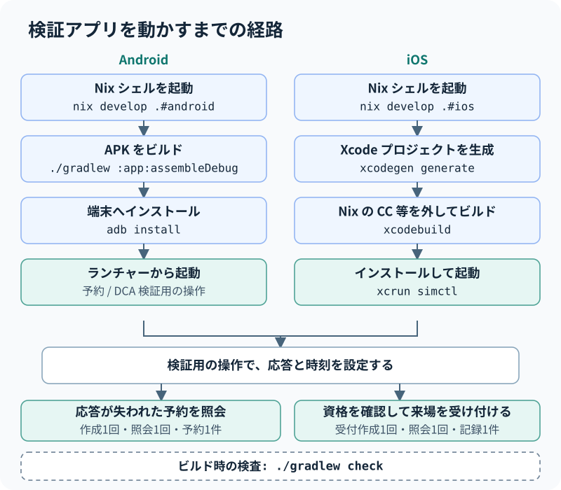

# KMP 版の検証アプリを実行する

ワークショップ予約の検証用アプリの Gradle ルートは `examples/reservation-mobile/` です。開催回の選択、参加資格の確認、予約、来場受付を Compose Multiplatform の共通画面で操作できます。検証画面では、外部サービスの応答や時刻を変えて境界条件を再現できます。[ソースコードの構成](../../examples/reservation-mobile/README.md)

SwiftUI 版を実行する場合は、専用の手順を参照してください。 [SwiftUI 版の実行手順](../../examples/reservation-ios/README.md)



## Android で実行する

Apple Silicon の macOS では、リポジトリのルートから Android 用の Nix シェルを起動してください。このシェルは、Nixpkgs の Android SDK ライセンス同意設定を使い、JDK 21 と Android SDK を用意します。

```sh
nix --extra-experimental-features 'nix-command flakes' develop .#android
cd examples/reservation-mobile
./gradlew :app:assembleDebug
```

端末を接続するかエミュレーターを起動し、`examples/reservation-mobile/` で `adb install -r app/build/outputs/apk/debug/app-debug.apk` を実行してください。

ほかの対応ホストでは [Kotlin/JVM サンプル用の Nix シェル](../../examples/reservation-jvm/README.md) で JDK 21 を用意し、Android SDK Platform 37 と Build Tools 37.0.0 を含む SDK を `ANDROID_HOME` に指定してください。変更実験を実行する場合は Python 3 も必要です。

Android Studio で `examples/reservation-mobile/` を開き、Android 8.0（API 26）以降の端末またはエミュレーターを選んで `app` を実行してください。ランチャーに「ワークショップ予約」と「DCA 検証用の操作」が表示されます。

## iOS で実行する

Apple Silicon の macOS では、Xcode と iOS Simulator ランタイムを用意してください。リポジトリのルートから iOS 用の Nix シェルを起動し、Xcode プロジェクトを生成してください。

```sh
nix --extra-experimental-features 'nix-command flakes' develop .#ios
export DEVELOPER_DIR="$(env -u DEVELOPER_DIR /usr/bin/xcode-select -p)"
cd examples/reservation-mobile/iosApp
xcodegen generate
xcrun simctl list devices available
```

共通コードの iOS Simulator ターゲットは ARM64 です。一覧から iPhone のシミュレーターを選び、下の `<UDID>` をその ID に置き換えてください。Xcode が SDK とコンパイラ、リンカーを選べるよう、ビルドコマンドでは Nix シェルの設定を外します。共通フレームワークは Xcode のビルド時に Gradle が生成します。

```sh
env -u CC -u CXX -u LD -u SDKROOT \
  xcodebuild -project DcaApp.xcodeproj -scheme DcaApp \
  -destination 'id=<UDID>' -derivedDataPath build build
```

シミュレーターを起動し、ビルドしたアプリをインストールしてください。

```sh
xcrun simctl install '<UDID>' build/Build/Products/Debug-iphonesimulator/DcaApp.app
xcrun simctl launch '<UDID>' example.reservation.dca
```

検証用のタブを表示するには、起動時に `-dca-verification` を渡します。同じプロセスの「予約」と「検証用の操作」を切り替えると、予約を保持したまま時刻やサービス応答を変えられます。

```sh
xcrun simctl launch --terminate-running-process '<UDID>' example.reservation.dca -dca-verification
```

## 応答が失われた予約を照会する

Android ではランチャーの「DCA 検証用の操作」、iOS では `-dca-verification` を指定した起動時の「検証用の操作」タブから、サービスの応答と時刻を設定します。

1. 検証用の操作を開き、「次の予約作成の応答」で「成立して応答喪失」を選びます。
2. 「ワークショップ予約」を開き、開催回と参加者を選びます。「内容を確認する」を押し、「この内容で予約する」で送信してください。
3. 「結果不明」が表示されたら、一覧に戻って別の開催回を選びます。一覧の「予約の状況を開く」から、最初に送信した開催回の状態を確認します。
4. 「状況を照会する」を押します。「予約確定」と予約番号が表示されます。検証用の操作に戻り、作成要求1回、照会1回、成立した予約1件を確認します。

検証用画面では、次の応答、保留の解放、開催回の開始時刻、取消期限も指定できます。シナリオを最初から試す場合は、検証用アプリのプロセスを終了して開き直してください。

## 資格を確認して来場を受け付ける

1. 「上級ろくろ陶芸」を開き、「佐藤 あかり」と「鈴木 こうた」を選びます。「資格を確認する」を押し、2人とも「資格あり」になったら予約を送信します。
2. 検証用の操作で、受付作成の応答を「記録して応答喪失」に設定します。「上級ろくろ陶芸」の時刻を「受付開始ちょうど」に進めます。
3. 予約状況に戻り、佐藤さんを受け付けます。「受付結果不明」が表示されます。鈴木さんは「未受付」のままです。
4. 一度ホーム画面に戻ってからアプリを再表示し、佐藤さんの受付結果を照会します。佐藤さんは「受付済み」になります。
5. 検証用の操作で、受付作成1回、受付照会1回、佐藤さんの受付記録1件を確認します。

## ビルド時の検査を実行する

`examples/reservation-mobile/` で `./gradlew check` を実行してください。Apple Silicon の macOS では iOS Simulator 向けのテストも実行します。Nix シェルを起動したあとに `DEVELOPER_DIR` に Xcode の場所を設定してください。`xcode-select` が Xcode を選んでいる環境では次のコマンドで設定できます。

```sh
export DEVELOPER_DIR="$(env -u DEVELOPER_DIR /usr/bin/xcode-select -p)"
./gradlew check
```

[detekt の運用ルール](../detekt-rules.md)には、ルールが検出する書き方と、予約アプリでの適用範囲を記載しています。[仕様変更を使った検証](../verification.md)には、コンパイルやビルドの検査とは別に、操作と要求回数を使って確認する項目があります。
