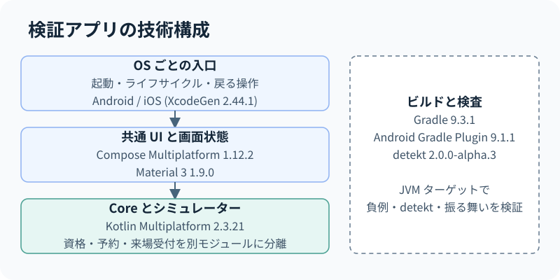

# 検証アプリの技術選定

アプリは Android と iOS を対象とします。画面と画面状態の管理は Compose Multiplatform、業務 Core と検証用シミュレーターは Kotlin Multiplatform の共通コードに置きます。各 OS の入口は起動、ライフサイクル、戻る操作の接続を担当します。

| 技術 | 用途 |
| --- | --- |
| Kotlin Multiplatform 2.3.21 | 参加資格、予約、来場受付の Core を別モジュールでコンパイルする |
| Compose Multiplatform 1.12.2 と Material 3 1.9.0 | 開催回の選択から来場受付までの画面を共通実装する |
| Gradle 9.3.1 と Android Gradle Plugin 9.1.1 | コンパイル境界を定義し、Android アプリをビルドする |
| Xcode と XcodeGen 2.44.1 | iOS のビルド定義からプロジェクトを生成し、共通の Compose 画面をアプリに組み込む |
| detekt 2.0.0-alpha.3 | 型解決を使って、判断の網羅性や呼び出し元の制約を検査する |

JVM ターゲットは、コンパイル負例、detekt、共通コードの振る舞いの検証に使います。OS ごとの起動、画面操作、ライフサイクル接続の結果は [検証記録](verification-results.md) に記録します。

Core 間の依存と Port の関係は [3つの Core の判断契約](core-contracts.md) の図にあります。外部サービスへの接続はシミュレーターで代替します。資格、予約、来場受付の応答や時刻を独立に操作すると、応答喪失や資格の期限切れを再現できます。

バージョンは [Gradle のバージョンカタログ](../../examples/reservation-mobile/gradle/libs.versions.toml) と [Gradle Wrapper](../../examples/reservation-mobile/gradle/wrapper/gradle-wrapper.properties) で管理します。
