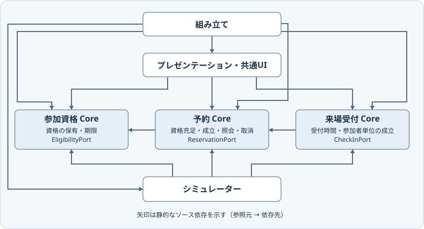

# 3つの Core の判断契約

参加資格 Core は資格を使えるかを決めます。予約 Core はその資格で参加者全員の予約を進められるかを決めます。来場受付 Core は、現在有効な予約を使って、その参加者をいま受け付けられるかを決めます。

図の矢印は、参照する側から静的なソース依存先を指します。予約 Core は参加資格 Core の公開契約を参照し、来場受付 Core は予約 Core の公開契約を参照します。基準仕様の来場受付 Core から参加資格 Core への依存はありません。

| 所有者 | その Core が決めること | その Core が発行するもの |
| --- | --- | --- |
| `:eligibility-core` | 資格の保有、種別、有効期限 | 対象の参加者と資格種別に結び付いた `EligibilityCertificate` |
| `:reservation-core` | 下書き、参加者全員の資格充足、送信、照会、取消、来場に使える予約か | `ConfirmedDraft`、予約の照会・再試行・取消の権限、参加者別の `ReservationAdmission` |
| `:checkin-core` | 受付時間、受付の成立、同じ予約・参加者の重複、元の要求の照会と再試行 | 元の受付に結び付いた `CheckInStatusTicket` と `CheckInRetryTicket` |

外部サービスの Port は、操作を必要とする Core が所有します。`:adapter-simulator` は Port を実装し、`:shared` で各 Core に渡します。`:ui` は Core の結果から画面状態を作ります。`:kernel` は共有する識別子と時計を持ちます。

確認済みの値は発行元 Core のコンパイル境界内で生成します。発行権限の静的検査に加え、値を使う時点で対象や時刻を確認します。予約の作成・再試行では、参加資格 Core がサービスから全員分の資格の観測を取り直し、一つの判定時刻で期限を照合します。予約 Core は参加者集合と資格種別を照合します。

予約の成立記録は成立時の資格条件を保持します。受付では予約 Core が成立記録とサービスの現在状態を確認します。予約取消が成立して応答だけを失った場合も、現在状態の照会で受付を止めます。受付 Core は、その照会の後で受付時間を判定してから受付を作成します。

- [参加資格の要件](qualification.md)
- [来場受付の要件](check-in.md)
- [画面と操作](screens.md)
