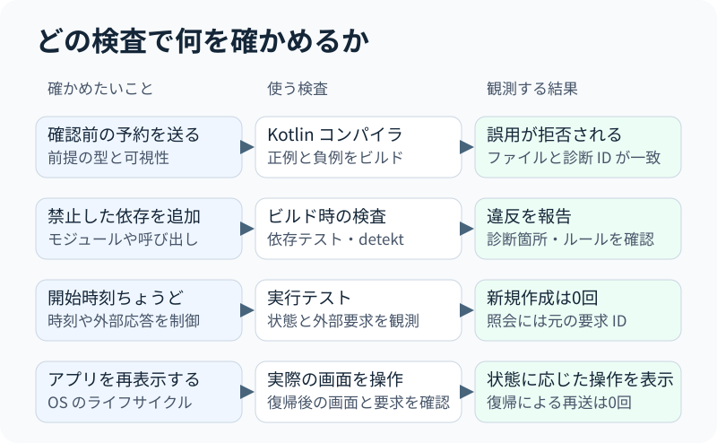
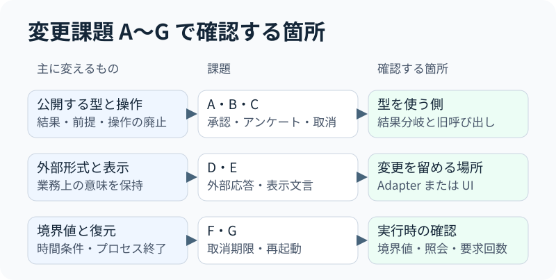
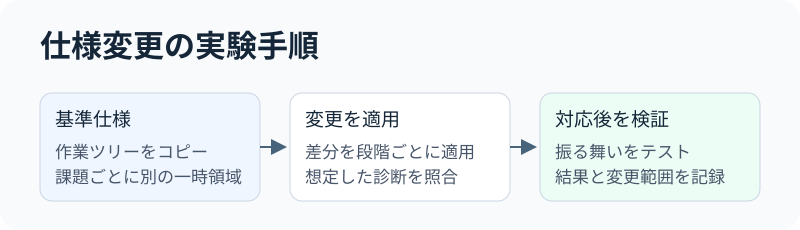

# 仕様変更を使った検証

仕様を変更し、見直しが必要な箇所に想定した診断が出るか、関係のない箇所まで修正が必要になるかを確認します。修正後は新しい仕様を満たす動作になっているかをテストします。

## 保証ごとに検証する



たとえば、送信を拒否する条件を `now >= start` から `now > start` に変えると、開始時刻ちょうどにも送信できてしまいます。型は変わらないため、開始時刻ちょうどの動作をテストして検出します。コンパイルで誤用を拒否できたかを確かめるときは、失敗したファイルと診断を照合します。依存不足によるコンパイル失敗は、対象の誤用を検出した証拠になりません。

## 予約アプリで評価する変更



課題ごとに基準仕様を起点として、変更後に見直す箇所を確認します。付属の Kotlin/JVM サンプルでは、課題 A のうち画面状態への変換を検証できます。課題 F の実行結果は検証記録にあり、B〜E と G は表に確認項目を示します。[サンプルの実行手順](../examples/reservation-jvm/README.md) · [検証記録](mobile-app/verification-results.md)

| 課題 | 見直しを求める場所と確認方法 |
| --- | --- |
| A. 承認待ちを追加する | Core の判断、画面状態への変換、画面表示を順に直す。承認待ちで枠を確保せず、承認時点で空きを確認する動作は実行テストで確認する |
| B. 事前アンケートを必須にする | 新しい送信前提をシグネチャに反映し、旧入力を使う呼び出しを拒否する |
| C. アプリから取消を削除する | 廃止した操作を公開契約から外し、残った呼び出しを拒否する。既存の取消済み履歴は引き続き読めることを確認する |
| D. 外部応答の形式を変える | Adapter の解釈と契約テストを更新する。業務上の意味が同じ場合、Core と表示の契約はそのままコンパイルできる |
| E. 表示文言を変える | 画面の文字列を更新し、Core の判断や許可する操作に修正が波及しないことを確認する |
| F. 取消期限の比較演算子だけを誤ったものに変える | コンパイルが成功し、取消期限ちょうどの動作を確かめるテストが失敗することを確認する |
| G. プロセス終了後の復元を追加する | プロセス終了後にアプリを起動し、永続情報を使って元の要求を照会する。二重送信が起きないことを確認する |

比較対象にも閉じた結果型や通常の責務分離を備え、同じ要求、時刻、外部応答を使います。比較では、同じ変更でどの対応漏れを検出できたか、どこまで修正が必要になったかを見ます。DCA では、どの処理で Kotlin の網羅性チェックを使うかを設計時に決めます。

## 3つの Core を使う変更実験



[課題 H〜L](README.md#仕様変更の検証)は、それぞれ同じ基準仕様に適用します。[実行スクリプト](../examples/reservation-mobile/verification/experiments/run.py)は作業ツリーのアプリをコピーし、実験ごとに別の一時ディレクトリで差分を適用します。各段階でコンパイル診断やテスト結果を記録します。

Android 用の Nix シェルを使い、リポジトリのルートから実行します。`all` を `h`、`i`、`j`、`k`、`l` のいずれかに変えると、その課題だけを実行できます。

```sh
python3 examples/reservation-mobile/verification/experiments/run.py all --evidence runs/experiments
```

実際に確認した結果は [検証記録](mobile-app/verification-results.md) を参照してください。

制約ごとの検出力を確かめるには、[比較 C1〜C3](experiments/contract-comparisons.md) を実行します。たとえば、網羅性を `else` で弱める比較では、Kotlin のコンパイルが成功してから detekt の診断を確認します。
