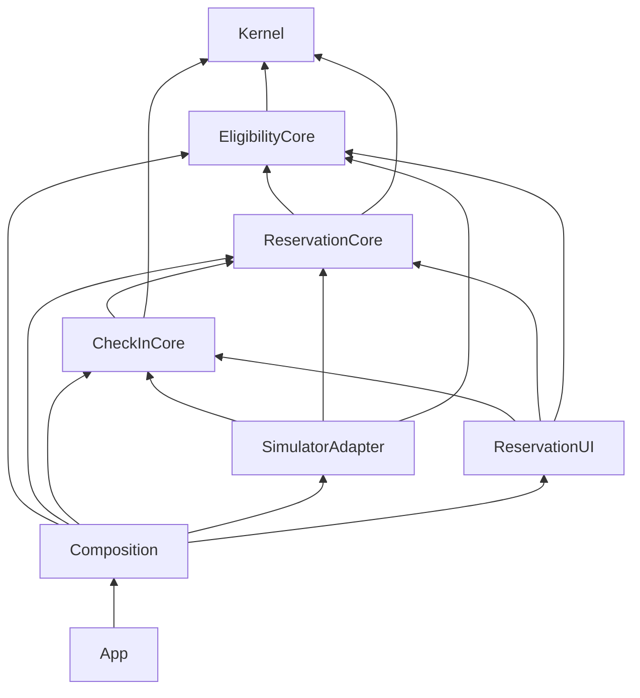

# ワークショップ予約の iOS ネイティブ実装

[KMP 版の検証アプリ](../reservation-mobile/README.md)と同じ参加資格・予約・来場受付の仕様を Swift で実装しています。画面は SwiftUI で描画し、`AsyncStream` で Core の状態を購読します。 [3つの Core の判断契約](../../docs/mobile-app/core-contracts.md)

アプリの対象は iOS 16 以降です。各 Package は Swift 6 言語モードを使い、macOS の最低バージョンを 13 に設定しています。Core・Adapter・画面状態のテストは macOS 上の `swift test` で実行できます。

## 構成と依存方向



矢印の向きは、参照するモジュールから直接の依存先へ向かいます。`SimulatorAdapter`・`ReservationUI`・`Composition` から `Kernel` への矢印は省略しています。

| モジュール | 役割 | 直接依存する Package |
| --- | --- | --- |
| `Kernel` | 識別子、時計、状態の購読（`Store`）、発行物のマーカー | なし |
| `EligibilityCore` | 資格の保有と期限の判定、再確認 | `Kernel` |
| `ReservationCore` | 予約の下書き、送信、照会、取消、来場受付に使える予約かどうかの確認 | `Kernel`、`EligibilityCore` |
| `CheckInCore` | 受付時間の判定、参加者ごとの受付、元の要求の照会 | `Kernel`、`ReservationCore` |
| `SimulatorAdapter` | 外部サービスの応答の再現、要求回数と記録件数の観測 | `Kernel`、3つの Core |
| `ReservationUI` | 画面状態への変換、ViewModel、SwiftUI の画面 | `Kernel`、3つの Core |
| `Composition` | Core とシミュレーターの組み立て、検証用の操作画面 | 上記の6 Package |
| `App/` | XcodeGen の定義、アプリの起動 | `Composition` |

`Package.swift` の依存方向は `Tools/ArchitectureCheck` が検査します。`CheckInCore` が `EligibilityCore` に依存する宣言や、`ReservationUI` が `SimulatorAdapter` に依存する宣言は、違反として検出されます。

## 起動する

Xcode 27、iOS Simulator ランタイム、XcodeGen を用意し、リポジトリのルートで次を実行します。 [XcodeGen](https://github.com/yonaskolb/XcodeGen)

```sh
cd examples/reservation-ios/App
xcodegen generate
xcodebuild -project ReservationIos.xcodeproj -scheme ReservationIos \
  -destination 'generic/platform=iOS Simulator' -derivedDataPath build build
xcrun simctl list devices available
```

一覧から iPhone の Simulator を選び、Xcode または Simulator アプリで起動します。その機器の ID で `<UDID>` を置き換え、同じディレクトリで実行します。

```sh
xcrun simctl install '<UDID>' build/Build/Products/Debug-iphonesimulator/ReservationIos.app
xcrun simctl launch '<UDID>' example.reservation.ios
```

外部サービスの応答や時刻を変えるには、起動時に `-dca-verification` を渡します。同じプロセスの「予約」と「検証用の操作」のタブを切り替えると、予約を保持したまま応答や時刻を変えられます。

```sh
xcrun simctl launch --terminate-running-process '<UDID>' example.reservation.ios -dca-verification
```

Xcode から実行するときは、`App/ReservationIos.xcodeproj` を開きます。

### 応答が失われた予約を照会する

1. 「検証用の操作」で「次の予約作成の応答」の「成立して応答喪失」を選びます。
2. 「予約」で「はじめてのろくろ陶芸」と参加者を選び、「内容を確認する」「この内容で予約する」を順に押します。
3. 予約の状況に「結果不明」が出ます。「状況を照会する」を押すと「予約確定」になります。
4. 「検証用の操作」で、作成要求 1 回、照会 1 回、成立した予約 1 件を確認します。

資格の確認と来場受付は、KMP 版と同じ手順で試せます。送信や照会などの主な操作に、Kotlin 版の `testTag` と同じ文字列の `accessibilityIdentifier` を付けています。 [資格を確認して来場を受け付ける](../../docs/mobile-app/setup.md#資格を確認して来場を受け付ける)

資格の表示や送信・取消・受付の操作は、現在時刻に応じて変わります。時間の条件で実行できない操作には、理由や次にできることを表示します。結果不明の予約や受付は、送信期限や来場受付時間が過ぎても元の要求を照会できます。

## 検査する

リポジトリのルートから `examples/reservation-ios/` に移動してください。初回は `bootstrap-swiftlint.sh` で SwiftLint 0.65.1 を取得します。配布ファイルの SHA-256 が一致すると、実行ファイルが `.tools/` に入ります。

```sh
cd examples/reservation-ios
sh Tools/bootstrap-swiftlint.sh
sh Tools/check.sh
```

`check.sh` で実行する検査は、SwiftLint、境界検査、各 Package のテストです。`--with-app` を付けると iOS Simulator 向けのビルドも実行します。別の SwiftLint を使う場合は、環境変数 `SWIFTLINT` に実行ファイルを指定してください。

### 個別の検査

| 確認 | コマンド |
| --- | --- |
| 規約 | `.tools/swiftlint lint --strict Packages App Tools/ArchitectureCheck/Sources Tools/ArchitectureCheck/Tests` |
| 境界（宣言・import・発行物・コンパイル・SwiftLint の負例） | `swift run --package-path Tools/ArchitectureCheck architecture-check all --root "$PWD"` |
| 各 Package のテスト | `swift test --package-path Packages/<Package>` |
| 検査自体のテスト | `swift test --package-path Tools/ArchitectureCheck` |

## 規約をどこで守るか

| 守りたいこと | 手段 |
| --- | --- |
| 発行物（資格の証明書、確認済みの下書き、各操作券、受付前提）を発行元の外で構築しない | `internal init` と `final class`。外から構築するコードを `swiftc` で型検査し、期待した診断の error が一件だけ出ることを `Tools/ArchitectureCheck/Fixtures/compile/reject/` で確認する。発行物ごとの負例がなければ検査が失敗する |
| 結果の分岐を網羅する | Swift の `switch` の網羅性。`default` などで隠すことを SwiftLint が禁じる |
| Package の依存方向と、宣言していない依存の `import` | `swift package dump-package` の結果と、各ソースの `import` を `ArchitectureCheck` が照合する。SwiftPM は未宣言の推移的な `import` をコンパイルできてしまうため、この検査が必要 |
| 他の Package の内部を見せる `@testable import` | `ArchitectureCheck` が、自分の Package 以外への使用を禁止する |
| 型が運ぶ別の Package の型を、宣言なしに使わない | `MemberImportVisibility` を全 Package で有効にし、コンパイラが拒否する |
| テスト支援のターゲットを本番が使わない | `ArchitectureCheck` が依存宣言を検査する |
| 組み立て関数の呼び出し元、Port の呼び出し元 | SwiftLint の独自規則（下記） |

## SwiftLint の静的判定の範囲

SwiftLint は型を解決せず、行の文字列と置き場所で判定します。次の独自規則は `.swiftlint.yml` にあり、問題例と正例を `Tools/ArchitectureCheck/Fixtures/lint/` に置いて、検出される行と検出されない行を毎回確認します。

| 規則 | 検出するもの | 検出できないもの |
| --- | --- | --- |
| `no_default_in_switch` | `Kernel`・各 Core・`ReservationUI`・`Composition` の `Sources` にある `default:`、`@unknown default:`、`case _:` の行 | `case .a, _:` や `case let other:` のように、行頭が `case _:` でない包括的な分岐。型は見ないため、判断の型以外の `switch` も対象になる。外部入力の解釈は対象外の `SimulatorAdapter` に置く |
| `restricted_factory_call` | `makeEligibilityCore`・`makeReservationCore`・`makeCheckInCore` の名前が、`Composition`、各 Core の `Factory.swift`、`TestSupport`、`Tests` の外に現れる行（呼び出しと参照の両方） | 同じ名前の別の関数は区別できず、誤検出する |
| `eligibility_port_call` `reservation_port_call` `check_in_port_call` | `.fetchQualification(` などの Port の呼び出しが、所有する Core の `Sources` の外にある行 | メソッド名で判定する。Port のメソッド名は Package をまたいで一意にしてある。同じ名前の別のメソッドは誤検出し、`(` の無い参照（`let f = port.createReservation`）や別名の包みは見逃す。ViewModel のメソッド名が Port と重なって誤検出された例があり、名前を変えて避けた |
| `evidence_construction` | `*Evidence.swift` にある `public init`、`open init`、`open class`、`public class` | 他のファイルに置かれた発行物。置き場所は `ArchitectureCheck` が検査し、`IssuedEvidence` を採用する型が `*Evidence.swift` 以外にあれば失敗する |

どの手段でも機械的に検査していないものがあります。Kotlin 版の `RequiredEvidenceParameter` に当たる、発行物を受け取る公開操作の引数に Optional や既定値を付けないことの検査は、この例に入れていません。現在の公開操作（`submit`、`checkStatus`、`retry`、`cancel`、`checkIn` など）は、どれも Optional や既定値のない引数で受け取っています。

## 変更するとき

- Package の依存や発行物を足したら、`Tools/ArchitectureCheck/Sources/ArchitectureRules/Policy.swift` の許可の表と、発行物の負例（`Forge<型名>.swift`）を同じ変更で更新します。
- 時刻で決まる操作の可否は Core が持ちます。画面に期限の計算を足さず、Core の `registrationGate`・`cancellationGate`・`window(for:)` を使います。
- 規則を足したときは、検出する問題例と検出しない正例を、`Fixtures/lint/` か `Fixtures/compile/` に置きます。
