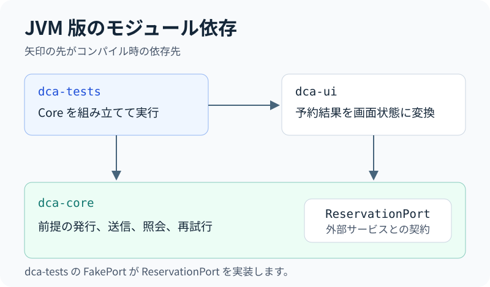
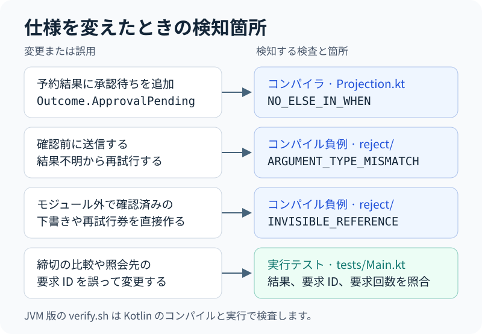
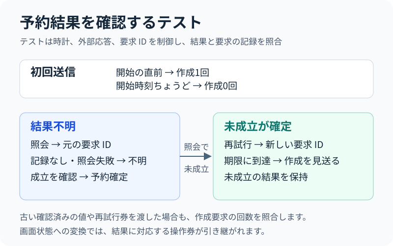

# JVM 版の判断契約

[実行手順](../README.md) · [モバイル版の図解](../../reservation-mobile/docs/README.md) · [ドキュメント索引](../../../docs/README.md)

## 依存関係

Core が予約の結果と次の操作に必要な値を返します。UI は結果に対応する画面状態を選び、照会券や再試行券を引き継ぎます。 [Core](../core/ReservationCore.kt) · [Port](../core/Port.kt) · [画面状態への変換](../ui/Projection.kt)

## 仕様変更の検知

`verify.sh` は一時コピーの `Outcome` に承認待ちを追加します。Core のコンパイルが通り、`Projection.kt` の `when` で期待した診断が出ることを確認します。 [検証スクリプト](../verify.sh) · [コンパイル負例](../reject/)

## ユニットテスト

結果や要求回数を `check` で照合する9件のシナリオを `Main.kt` で実行します。空や重複のある参加者一覧の拒否と、送信後に確認し直しても作成が増えないことも確認します。 [テストコード](../tests/Main.kt)

## detekt

JVM 版の検査は `kotlinc` と実行テストで構成されます。detekt の適用例はモバイル版で確認できます。 [モバイル版の detekt](../../reservation-mobile/docs/README.md#detekt) · [ルール仕様](../../../docs/detekt-rules.md)
