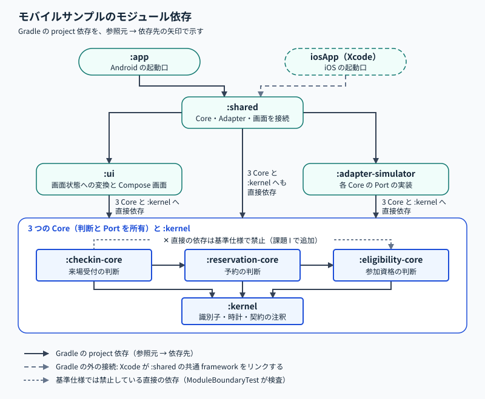

# ワークショップ予約の検証アプリ

Android・iOS の共通画面で、参加資格の確認、ワークショップの予約、来場受付を操作できます。検証用画面では外部サービスの応答と時刻を変えられます。

[依存関係と検査の図解](docs/README.md)

| ディレクトリ | 役割 |
| --- | --- |
| [core/](core/) | 参加資格、予約、来場受付を判断する3つの Core と共通の型 |
| [adapter-simulator/](adapter-simulator/) | 外部サービスの応答と状態を再現する Adapter |
| [ui/](ui/) | Compose の共通画面と Core の状態の表示 |
| [shared/](shared/) | Core、Adapter、画面を組み立てる共通コード |
| [app/](app/)・[iosApp/](iosApp/) | Android と iOS の起動口 |
| [verification/](verification/) | detekt ルール、モジュール境界とコンパイル診断の検査、変更実験 |

Gradle のコマンドはこのディレクトリで実行します。モジュールの位置と Gradle のプロジェクト名は [settings.gradle.kts](settings.gradle.kts) で確認できます。

[ビルドと実行](../../docs/mobile-app/setup.md) · [3つの Core の判断契約](../../docs/mobile-app/core-contracts.md) · [detekt の運用ルール](../../docs/detekt-rules.md) · [変更実験の実行](../../docs/verification.md#3つの-core-を使う変更実験)
