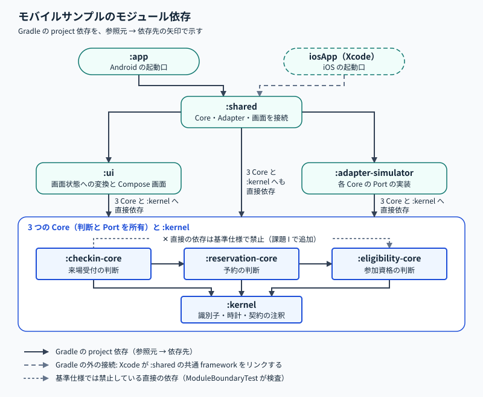
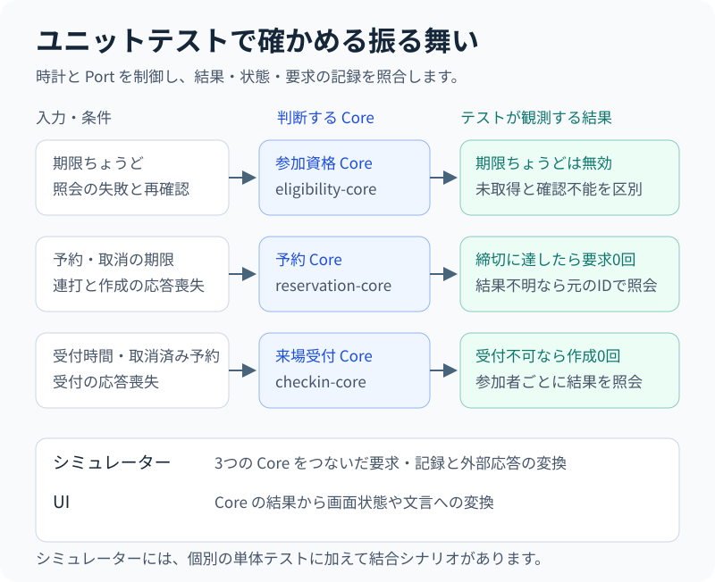
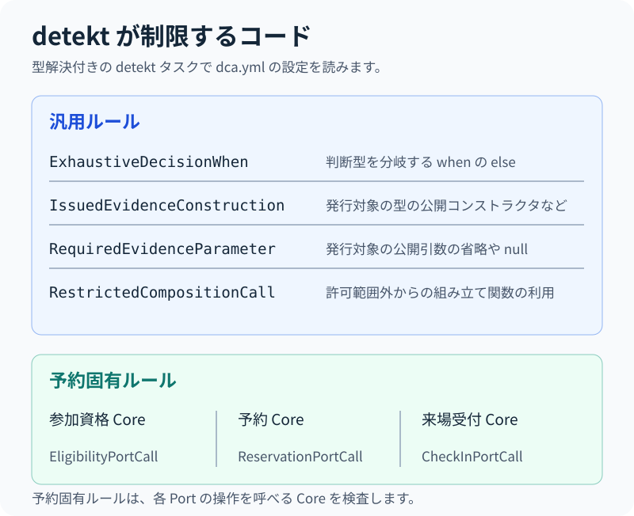

# モバイル版の判断契約

[実行手順](../../../docs/mobile-app/setup.md) · [JVM 版の図解](../../reservation-jvm/docs/README.md) · [ドキュメント索引](../../../docs/README.md)

## 依存関係

各 Core が Port を定義し、`:adapter-simulator` が実装し、`:shared` が接続します。図は外部ライブラリと検証用モジュールを省き、各 Core への依存を枠にまとめています。 [3つの Core の判断契約](../../../docs/mobile-app/core-contracts.md) · [モジュール一覧](../settings.gradle.kts)

基準仕様では、来場受付 Core から参加資格 Core の型が予約 Core 経由で見えます。直接の依存宣言と import は `ModuleBoundaryTest` が検査します。 [依存方向の検査](../verification/conformance/src/test/kotlin/example/reservation/conformance/ModuleBoundaryTest.kt) · [来場時に資格を再確認する実験 I](../../../docs/experiments/i-check-in-qualification.md)

## 仕様変更の検知

H・J では `when` の網羅性、I では受付の引数型と拒否理由の網羅性、K では削除した操作への参照、L では名前付き引数と必須引数に診断が出ます。 [診断と対応後の記録](../../../docs/mobile-app/verification-results.md#変更実験-hl) · [実験の定義](../verification/experiments/)

型が合うまま取消期限の比較を誤ると境界値のテストが失敗します。判断型の `when` に `else` を加えるとコンパイルは通り、detekt が違反を報告します。 [期限の検証記録](../../../docs/mobile-app/verification-results.md#基準仕様) · [網羅性を弱める比較 C1](../../../docs/experiments/contract-comparisons.md)

## ユニットテスト

各 Core の `commonTest` には、時刻と外部応答を制御したテストがあります。シミュレーターの `AcceptanceTest` は3つの Core を接続して一連の振る舞いを確認します。

- [参加資格 Core](../core/eligibility-core/src/commonTest/kotlin/example/eligibility/core/) · [予約 Core](../core/reservation-core/src/commonTest/kotlin/example/reservation/core/) · [来場受付 Core](../core/checkin-core/src/commonTest/kotlin/example/checkin/core/)
- [シミュレーター](../adapter-simulator/src/commonTest/kotlin/example/adapter/simulator/) · [画面状態への変換](../ui/src/commonTest/kotlin/example/reservation/ui/) · [コンパイル契約のテスト](../verification/compile-contracts/src/test/kotlin/example/contracts/CompileContractsTest.kt)

## detekt

`./gradlew check` は Android と JVM の型解決付きタスクを実行し、KMP の `commonMain` も検査します。`:conformance` は違反を含むコードで、期待したルール名と行に診断が出ることを確かめます。 [detekt の設定](../verification/config/detekt/dca.yml) · [適用のテスト](../verification/conformance/src/test/kotlin/example/reservation/conformance/ConformanceTest.kt) · [全ルールの仕様](../../../docs/detekt-rules.md)
